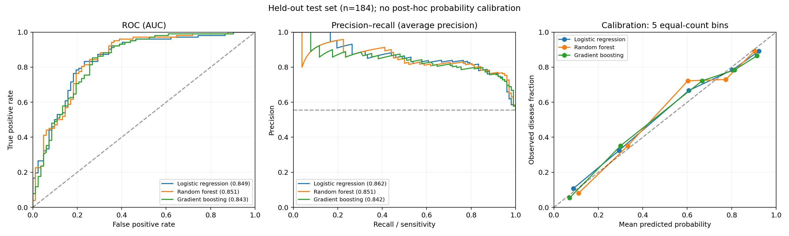

# Heart Disease: Model Complexity, Thresholds, and Hospital Shift

**Does a more complex model earn its place when the dataset is small and hospital cohorts differ?**

This study follows existing disease classification from data audit through model comparison, error
analysis, nested experiments, and transfer across four hospital cohorts. The target is angiographic
disease presence (`num > 0`), not a future cardiac event.

## What the experiments showed

- **Complexity did not demonstrate a clear benefit.** Initial test ROC-AUC ranged from 0.843 to 0.851.
  Training-only nested tuning also failed to improve the logistic baseline's ranking performance.
- **The error objective changed the decision.** In outer validation, training-selected logistic cutoffs
  reduced missed positives from 66 to 38, while false positives rose from 89 to 115.
- **Hospital transfer was the larger limitation.** When VA Long Beach was held out from training,
  all three models scored approximately 0.68–0.70 ROC-AUC.
- **Additional diagnostic information helped a different task.** Adding exercise results increased
  outer-validation ROC-AUC from 0.860 to 0.893, but moved prediction to after exercise testing.

These findings support a simpler initial-assessment reference model and more attention to operating
requirements and cohort shift. They do not establish clinical utility or a deployment-ready model.

## Read the study in order

| Stage | Question | Documentation |
| --- | --- | --- |
| Data audit | What do the fields mean, and what needs cleaning? | [Source, dictionary, and quality findings](docs/data_audit.md) |
| Methodology | What information is available at prediction time? | [Features, preprocessing, splits, and boundaries](docs/methodology.md) |
| Initial comparison | Do trees improve on a linear reference? | [Baseline results and hospital transfer](results/comparison_report.md) |
| Error analysis | What does each model get wrong? | [Confusion matrices and threshold tradeoffs](docs/error_analysis.md) |
| Follow-up | Is tuning, calibration, or a feature change worthwhile? | [Nested experiment report](results/experiments/experiment_report.md) |
| Decisions | What was tried, learned, and retained? | [Experiment journal](docs/experiment_journal.md) |

The journal is a retrospective account. Focused commits organize the completed study stages with
actual commit timestamps.

## Initial holdout: 184 records

Seven predictors: age, sex, chest-pain category, resting BP, cholesterol, fasting-sugar indicator, and
resting ECG. The source has 920 records; two duplicate copies are removed before the 734/184 split.

| Model | ROC-AUC | Average precision | Sensitivity | Specificity | Brier score ↓ |
| --- | ---: | ---: | ---: | ---: | ---: |
| Logistic regression | 0.849 | 0.862 | 83.3% | 76.8% | 0.152 |
| Random forest | 0.851 | 0.851 | 81.4% | 74.4% | 0.149 |
| Gradient boosting | 0.843 | 0.842 | 85.3% | 72.0% | 0.154 |

Threshold-dependent values use cutoff 0.5. Logistic regression had the highest mean training CV
ROC-AUC (0.858). Small test differences do not establish superiority. Average precision summarizes
precision–recall; it is not trapezoidal PR-AUC. Brier score assesses probability quality.


Boosting catches two more positive cases than logistic regression with four additional false alarms.
Model selection therefore needs an explicit error objective, rather than accuracy alone.



## Follow-up: training-only nested validation

The original test had already been inspected. New experiments use only the original 734 training
records, with five outer folds and three inner folds. All variants share the same outer folds;
hyperparameters, calibration, and thresholds are learned within the outer training partitions.

| Variant | Pooled outer ROC-AUC | Finding |
| --- | ---: | --- |
| Baseline logistic | 0.860 | Strong reference |
| Tuned logistic | 0.857 | No ranking gain |
| Tuned forest | 0.856 | No ranking gain |
| Tuned boosting | 0.853 | No ranking gain |
| Logistic without cholesterol | 0.855 | No mixed-source gain |
| Logistic without numeric missingness flags | 0.857 | No mixed-source gain |
| Sigmoid-calibrated logistic | 0.860 | Brier slightly worsened |
| After-exercise logistic | 0.893 | Separate, later prediction-time task |

An exploratory 90%-sensitivity target achieved 90.6% sensitivity and 64.9% specificity for baseline
logistic in outer validation. This is a research assumption, not a clinical requirement or a final
deployment cutoff. Conditional paired bootstrap intervals and all four confusion cells are in the
[full report](results/experiments/experiment_report.md).

## Reproduce

Use Python 3.11 or newer and the pinned dependencies. The original results were generated with
scikit-learn 1.6.1; the seed is 42. Create an isolated environment:

```sh
python -m venv .venv
source .venv/bin/activate
python -m pip install -r requirements.txt

python audit_data.py
OMP_NUM_THREADS=2 OPENBLAS_NUM_THREADS=2 python train_compare.py
OMP_NUM_THREADS=2 OPENBLAS_NUM_THREADS=2 python experiment.py
python visualize_errors.py
python -m unittest discover -s tests -v
```

The scripts preserve the source CSV and recreate the audit, deterministic split, predictions, plots,
and reports. Rerunning the baseline reproduces the same test evaluation; it does not create a new
confirmation set. Figures can be regenerated from saved counts without refitting models.

## Implementation and verification

- Numeric median imputation, missingness flags, one-hot encoding, and model-specific scaling live
  inside training pipelines. Zero cholesterol/BP are treated as missing; incomplete records are kept.
- ID, hospital, and later diagnostic features are excluded from baseline predictors. Hospital remains
  available for split stratification and transfer evaluation. No oversampling is applied.
- Saved split IDs, parameters, predictions, and metrics permit inspection without rerunning the search.
- Six automated checks verify source integrity, partition separation, target alignment, confusion counts,
  probability metrics, and missing-value/unseen-category behavior. GitHub Actions runs them on pushes
  and pull requests. They check integrity, not clinical validity.

```text
audit_data.py           Source audit and fingerprint
train_compare.py        Initial model comparison and hospital transfer
experiment.py           Nested tuning, calibration, and ablations
visualize_errors.py     Confusion matrices from saved results
docs/                   Data dictionary, methodology, error analysis, journal
results/                Initial metrics, row assignments, predictions, plots
results/experiments/    Follow-up parameters, outer predictions, reports, plots
tests/                  Artifact consistency and pipeline edge-case checks
```

## Limits and data attribution

The dataset is small, retrospective, and heavily affected by hospital-dependent missingness and
different source prevalences. Exact preprocessing history of this local derivative is unavailable.
No measurement timestamps, follow-up outcomes, or reliable patient identifiers establish prospective
validity. Subgroups can be very small. Conditional bootstrap intervals do not capture retraining
variation, fold dependence, or selection across experiments. New experiments have no untouched
confirmation cohort. No model was deployed or clinically validated.

Parent dataset: Janosi, A., Steinbrunn, W., Pfisterer, M., & Detrano, R. (1989),
[UCI Heart Disease](https://doi.org/10.24432/C52P4X), listed under
[CC BY 4.0](https://creativecommons.org/licenses/by/4.0/).
The local four-cohort CSV and its provenance limitations are described in the [data audit](docs/data_audit.md).
