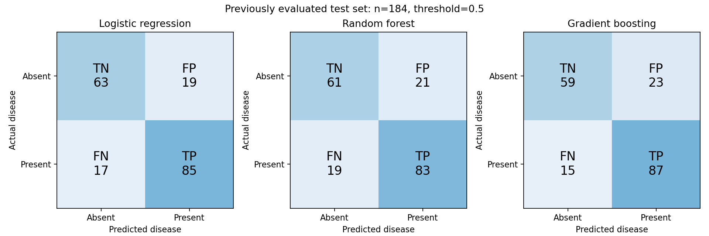

# Error analysis: what accuracy conceals

The initial test contains 102 positive and 82 negative records. At cutoff 0.5:

| Model | True negative | False positive | False negative | True positive |
| --- | ---: | ---: | ---: | ---: |
| Logistic regression | 63 | 19 | 17 | 85 |
| Random forest | 61 | 21 | 19 | 83 |
| Gradient boosting | 59 | 23 | 15 | 87 |

Rows are actual disease status; columns are predicted status. A false negative is a positive label
predicted absent. A false positive is a negative label predicted present. These labels describe
retrospective dataset errors; no actual screening or treatment decisions were made.

Boosting catches two more positive cases than logistic regression while producing four more false
positives. This is a different operating balance, not sufficient evidence that one model is better.
Accuracy hides the distinction. ROC-AUC evaluates ranking across cutoffs but does not choose an
operating point. A shared 0.5 cutoff also does not imply matched sensitivity across models.

## The first threshold experiment

Training out-of-fold predictions selected a logistic cutoff of 0.564 to target 80% sensitivity.
On test data it achieved 79.4% sensitivity and 78.0% specificity, compared with 83.3% and 76.8%
at 0.5. False negatives increased from 17 to 21 while false positives decreased from 19 to 18.

That threshold target was exploratory. It does not establish 0.564 or 0.5 as optimal, and the observed
test results must not be used to keep searching for a favorable cutoff. A meaningful comparison
requires an error-cost objective or a declared sensitivity target evaluated on unseen predictions.

## Generalization and probability quality

Holding out VA Long Beach from training yields baseline ROC-AUC 0.697 and specificity 36.6% at 0.5.
The mixed-hospital test is a different population, so its 0.849 AUC is not a directly paired comparison.
The gap nevertheless illustrates why a random split is not enough to claim hospital transportability.

Calibration curves and Brier/log loss complement the error counts: a model can rank cases well but
assign unreliable probabilities. Subgroup results are in `results/test_subgroups.csv`, but small groups
limit interpretation. There are only six female records in the full VA Long Beach cohort.

Regenerate the figures without fitting models: `python visualize_errors.py`.
