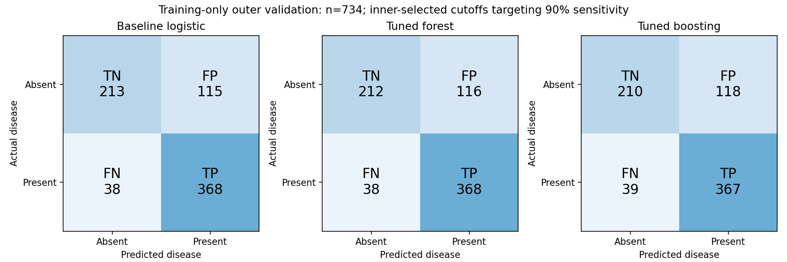

# Training-only experiments and error analysis

All new experiments use the original 734 training records only. The previously inspected test
set is not reused for selecting a model or threshold. The raw file and original results remain intact.

Five outer folds supply held-out predictions. Three inner folds select hyperparameters by ROC-AUC.
Within each outer training partition, inner OOF predictions select the largest cutoff achieving 90%
sensitivity. Outer predictions measure the achieved sensitivity and specificity; 90% is an exploratory
research target, not a clinical operating requirement. Threshold OOF estimates reuse hyperparameters
chosen on that outer training partition, but outer validation labels never select them.
For sigmoid calibration, all calibration fits are inside the outer training partition.
Preprocessing is fit inside each fit, including inner folds. No oversampling is applied.

## Full existing test confusion matrices

Rows are actual labels; columns are predicted labels. TN and TP are correct predictions;
FP is a false disease alarm; FN is missed disease. These are the original test results, not a new test.

## Nested outer-validation comparisons at 0.5

| model | roc_auc | average_precision | brier | sensitivity | specificity | tn | fp | fn | tp |
| --- | --- | --- | --- | --- | --- | --- | --- | --- | --- |
| Baseline logistic | 0.860 | 0.863 | 0.148 | 0.837 | 0.729 | 239 | 89 | 66 | 340 |
| Tuned logistic | 0.857 | 0.864 | 0.151 | 0.840 | 0.729 | 239 | 89 | 65 | 341 |
| Tuned forest | 0.856 | 0.851 | 0.153 | 0.845 | 0.710 | 233 | 95 | 63 | 343 |
| Tuned boosting | 0.853 | 0.850 | 0.152 | 0.855 | 0.716 | 235 | 93 | 59 | 347 |
| Logistic without cholesterol | 0.855 | 0.860 | 0.152 | 0.837 | 0.720 | 236 | 92 | 66 | 340 |
| Logistic without missing flags | 0.857 | 0.858 | 0.150 | 0.837 | 0.716 | 235 | 93 | 66 | 340 |
| Sigmoid-calibrated logistic | 0.860 | 0.862 | 0.151 | 0.860 | 0.701 | 230 | 98 | 57 | 349 |
| After-exercise logistic | 0.893 | 0.903 | 0.131 | 0.837 | 0.774 | 254 | 74 | 66 | 340 |

## Inner-selected cutoffs targeting 90% sensitivity

| model | sensitivity | specificity | precision | tn | fp | fn | tp |
| --- | --- | --- | --- | --- | --- | --- | --- |
| Baseline logistic | 0.906 | 0.649 | 0.762 | 213 | 115 | 38 | 368 |
| Tuned logistic | 0.904 | 0.662 | 0.768 | 217 | 111 | 39 | 367 |
| Tuned forest | 0.906 | 0.646 | 0.760 | 212 | 116 | 38 | 368 |
| Tuned boosting | 0.904 | 0.640 | 0.757 | 210 | 118 | 39 | 367 |
| Logistic without cholesterol | 0.906 | 0.616 | 0.745 | 202 | 126 | 38 | 368 |
| Logistic without missing flags | 0.906 | 0.631 | 0.753 | 207 | 121 | 38 | 368 |
| Sigmoid-calibrated logistic | 0.909 | 0.649 | 0.762 | 213 | 115 | 37 | 369 |
| After-exercise logistic | 0.889 | 0.713 | 0.793 | 234 | 94 | 45 | 361 |

## Paired AUC differences versus baseline

| model | auc_difference_vs_baseline | conditional_bootstrap_low | conditional_bootstrap_high |
| --- | --- | --- | --- |
| Tuned logistic | -0.003 | -0.008 | 0.002 |
| Tuned forest | -0.004 | -0.012 | 0.003 |
| Tuned boosting | -0.008 | -0.016 | -0.001 |
| Logistic without cholesterol | -0.006 | -0.013 | 0.001 |
| Logistic without missing flags | -0.004 | -0.010 | 0.002 |
| Sigmoid-calibrated logistic | -0.001 | -0.003 | 0.002 |
| After-exercise logistic | 0.032 | 0.014 | 0.049 |

Intervals use 1,000 paired, class-stratified bootstrap resamples of fixed outer predictions.
They describe uncertainty conditional on those predictions; they do not capture retraining variation,
dependence between CV folds, or multiple-experiment selection. They are descriptive, not a formal
claim of statistical significance. Fold results and selected parameters are saved separately.

## Observed findings

The baseline's pooled outer-validation ROC-AUC is 0.860. Neither tuned tree
model nor tuned logistic exceeds it in this experiment. Sigmoid calibration changes Brier score from
0.148 to 0.151, so it does not improve this probability-quality measure.
Removing cholesterol or numeric missingness flags also produces no AUC gain here; this does not
demonstrate that their hospital-transfer behavior is worse.

Training-selected sensitivity cutoffs change baseline missed cases from 66 to
38 and false positives from 89 to 115, achieving
90.6% sensitivity and 64.9% specificity.
This is an observable error tradeoff; choosing it requires a stated objective.

The after-exercise model's ROC-AUC is 0.893, a difference of
0.032 versus baseline, with Brier score 0.131.
That is evidence for the value of additional test information in a different workflow, not proof
that the initial-assessment model has been improved.

## Interpretation boundaries

Removing cholesterol tests dependence on a feature missing for an entire hospital. Removing numeric
missingness flags tests a possible source shortcut (categorical missingness still remains visible).
Sigmoid calibration tests probability quality, not just class accuracy. These comparisons do not
establish better hospital transfer; the earlier transfer experiment remains the evidence for that.
After-exercise logistic adds thalch, oldpeak, exang and slope, but excludes ca and thal. It answers a
different prediction-time question and cannot be called an improvement to initial-assessment prediction.
None of the models is clinically validated. This small retrospective dataset limits deployment claims.

Reproduce: `OMP_NUM_THREADS=2 OPENBLAS_NUM_THREADS=2 python experiment.py`.
